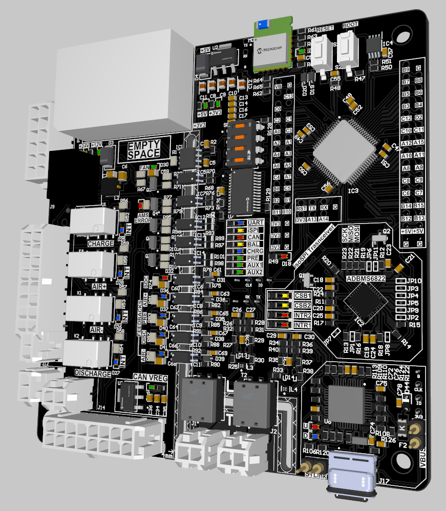

# BMS STM32F412 + ADBMS6830



Firmware do AMS master do TEK-26E: STM32F412RET6, 12 ADBMS6830B em isoSPI
(via ADBMS6822), 144s3p de Molicel P45B.

Mede as 144 células e os 72 NTC, a corrente e a tensão do pack (ISA IVT-S),
abre a linha AMS_ERROR quando a FS 2027 obriga, faz a pré-carga e o
carregamento, balanceia, e manda tudo para o CAN e para o Bluetooth (RN4871).
Toda a configuração vive na EEPROM e muda-se pelo BLE ou pelo cabo, sem
recompilar. O firmware grava-se pelo CAN, com o anterior guardado como backup
([BOOTLOADER.md](BOOTLOADER.md)).

## Hardware

- STM32F412RET6 (HSE 8 MHz, SYSCLK 64 MHz, PCLK1 32 MHz)
- ADBMS6822 + 12× ADBMS6830B (12 células e 6 NTC cada), SPI1 + isoSPI
- CAN1 (powertrain: VCU, ISA do pack, telemetria) e CAN2 (handcart, carregador EV Europe, ISA do handcart)
- EEPROM 24FC08 (1 KB) no I2C1, com a configuração
- RN4871 (BLE, UART transparente) no USART2; consola por cabo no USART1
- Contactores AIR+, AIR- e pré-carga, com feedback; feedback do SDC e da descarga
- Linha AMS_ERROR (PC8), ventoinha das células (TIM12 CH1)

## Arquitetura

Um único `bms_t bms` (`Core/Inc/brain.h`) com tudo o que se mede, decide e
configura. Cada bloco tem **um só módulo que o escreve**; os outros só leem.
Cada módulo tem a sua máquina de estados dentro de `bms`, avança um passo por
`brain_loop()` e **nunca espera dentro de uma função**: as esperas são estados
medidos pelo `HAL_GetTick()` ou pelo TIM5 (µs). O WWDG corta o `brain_loop` aos
~65 ms.

```
main.c ─ while(1): WWDG + brain_loop()
brain.c
  entradas   contactors (feedbacks/SDC)  can_messages (RX)  board (ADC)  console (UART1)  rn4871 (UART2)
  medição    adBms_Application (cadeia ADBMS, tick de 200 ms do TIM6)
  decisões   isa  soc  charger  precharge  fans  estado do AMS
  AMS_ERROR  ams_error (depois de todos os faults do ciclo)
  saídas     contactors (único escritor dos pinos)  can_messages (TX)  can_bus  live_json  uart_link  config_store
```

| Pasta | O quê |
|---|---|
| `Core/Inc/brain.h`, `Core/Src/brain.c` | o `bms_t` e a ordem do ciclo |
| `Core/adbms6830/` | cadeia ADBMS: leitura das células, temperaturas, open-wire, balanceamento (+ driver da ADI) |
| `Core/app/` | lógica: `precharge`, `charger`, `ams_error`, `faults`, `contactors`, `isa`, `soc`, `fans`, `board`, e o `bsp` (o único que conhece os pinos) |
| `Core/config/` | `bms_config` (tabela dos 102 parâmetros, defaults, gamas) e `config_store` (EEPROM em bancos A/B) |
| `Core/comms/` | `can_bus` (driver bxCAN), `can_messages` (DBC), `uart_link` (DMA), `rn4871`, `console`, `live_json` |
| `Core/boot/` | partilhado com o bootloader CAN: mapa da flash, journal, formato da imagem, SHA-256 |
| `Core/app/boot_ctrl.c` | o lado da aplicação do bootloader: confirmação da imagem nova, pedidos, rollback |
| `Core/DBC/` | gerado do T26_DBC, não editar |
| `Tests/` | testes no PC e compilação ARM sem o CubeIDE |
| `../Bootloader/` | o bootloader CAN (32 KB em `0x08000000`) e o uploader ([BOOTLOADER.md](BOOTLOADER.md)) |

Regras que o desenho garante:

- **Só o `ams_error.c` escreve no pino AMS_ERROR** e só o `contactors.c` escreve
  nos contactores. A pré-carga só pede; com AMS_ERROR ativo ou o SDC aberto
  fica tudo aberto, venha o pedido que vier.
- **Falha segura no arranque**: AMS_ERROR em erro desde a inicialização dos
  GPIO até à primeira leitura completa da cadeia.
- **Faults da FS 2027 sempre ligados**: sobretensão, subtensão, open-wire,
  sobre e subtemperatura, NTC em falha, slave em falta, dados velhos do ADBMS,
  sobrecorrente e ISA do pack calada abrem sempre a linha. A configuração só
  pode acrescentar outros (`ams_error_enable`).
- **Dados velhos não passam por bons**: uma leitura com PEC errado não é
  publicada e a idade dos dados conta (`adbms_data_timeout_ms`, 300 ms).
- **Nada bloqueia**: a EEPROM grava uma página de 16 B por passo, o CAN e os
  UART são servidos por filas, as listagens da consola saem uma linha de cada vez.

## Configuração e comunicação

- [CONFIGURACAO.md](CONFIGURACAO.md): os 102 parâmetros, a EEPROM em bancos
  A/B, os comandos da consola (BLE e cabo) e o PIN do BLE.
- [BOOTLOADER.md](BOOTLOADER.md): gravar pelo CAN, o backup do firmware
  anterior e quando o bootloader volta a ele.
- [LIVE_DEBUG_JSON.md](LIVE_DEBUG_JSON.md): a linha JSON que sai pelo RN4871 e
  pelo UART1 (a mesma que a [BMS_UI](https://github.com/FSLART/BMS_UI) já lê).

CAN (DBC `powertrain_t26` e `handcart_t26`):

| | CAN1 (powertrain) | CAN2 (carregamento) |
|---|---|---|
| Recebe | 0x083 START_PRE_CHARGE, 0x750 VCU_STATES, 0x521-0x528 ISA do pack, 0x0DC programador | 0x084 switch do handcart, 0x18FF50E5 carregador P1000, 0x521-0x528 ISA do handcart, 0x0DC e 0x601 (bootloader) |
| Envia | 0x701-0x706 e 0x709 (master, a cada `can_master_ms`), 0x600-0x653 (slaves, a cada `can_slaves_ms`) | 0x1806E5F4 pedido ao carregador; a telemetria também, a carregar |

Os filtros são por hardware: só entram os IDs da tabela acima. Os bitrates
vêm da config (`can1_kbps`, `can2_kbps`), com o ponto de amostragem a 87,5 %.

## Compilar

O projeto é do STM32CubeIDE (`Firmware/`). Depois de puxar ficheiros novos:
**Project → Clean** e **Build** (o CubeIDE regenera os makefiles do `Debug/`).
As pastas `Core/app`, `Core/comms`, `Core/config` e `Core/boot` já estão nas
include paths do `.cproject`.

A aplicação está ligada a `0x08010200`, depois do bootloader CAN: a placa tem
de ter o bootloader gravado uma vez (`Bootloader/`, ver
[BOOTLOADER.md](BOOTLOADER.md)). A partir daí o *Run*/*Debug* do CubeIDE
funciona como antes.

Sem o CubeIDE (verificação, CI), com o `arm-none-eabi-gcc`:

```bash
Firmware/Tests/build_arm.sh
```

```bash
make -C Bootloader
```

## Testes no PC

O código do firmware corre no PC tal como está; só o hardware é simulado (a
cadeia ADBMS, os pinos, a EEPROM, o CAN, os UART, o próprio RN4871 e as ISA).

```bash
Firmware/Tests/run_tests.sh
```

- `test_adbms`: a cadeia ADBMS (células, temperaturas, open-wire, balanceamento, PEC, tempos da FS)
- `test_system`: EEPROM A/B e corte de energia a meio da gravação, consola, PIN, RN4871, pré-carga (completa, AIR soldado, AIR- morto, bus que não sobe, SDC aberto, lockout), AMS_ERROR, ISA, SOC, carregamento, CAN, o JSON e o lado da aplicação do bootloader
- `test_wrapper`: o `mcuWrapper` (tempos do isoSPI)
- `test_boot`: o bootloader CAN numa flash simulada, com cortes de energia em cada escrita de um update
- `test_can_upload.py`: o uploader contra o bootloader num bus CAN virtual (se houver python-can e cantools)
