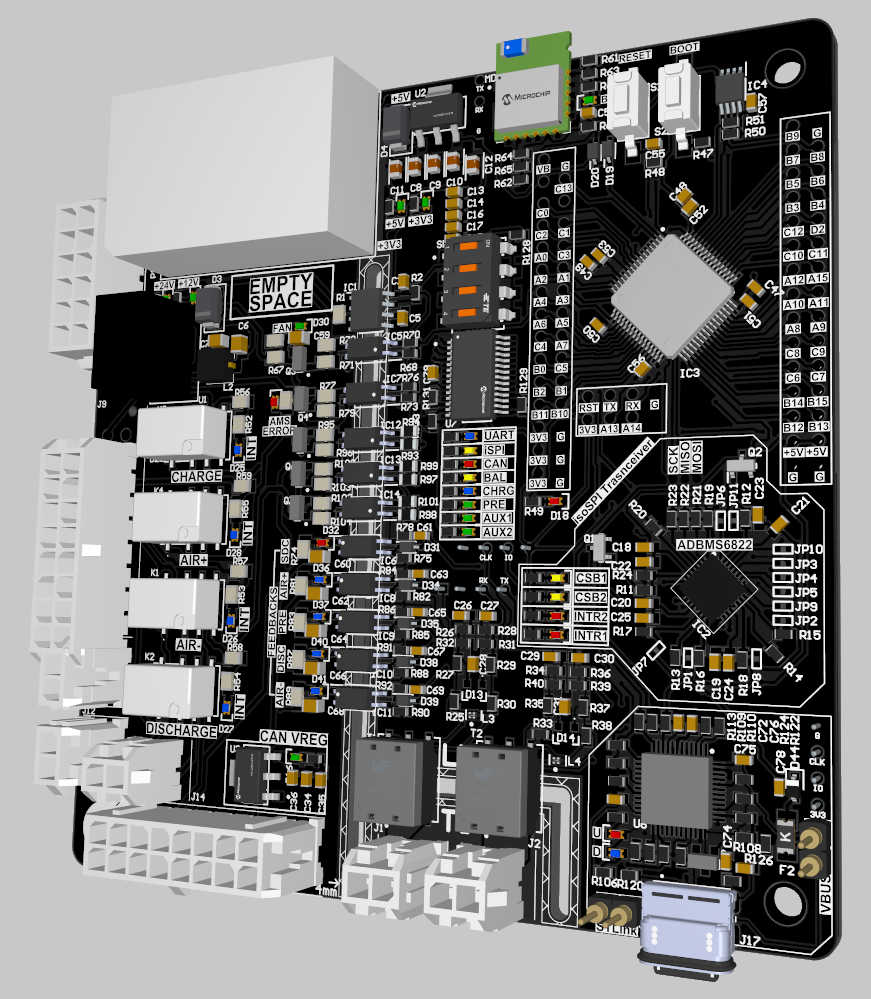

# BMS STM32F412 + ADBMS6830



Simple Battery Management System firmware for an STM32F412 master board using Analog Devices ADBMS6830 battery-monitor ICs.

The project reads cell voltages, temperatures, current sensor data and contactor feedback, then sends the important information over CAN to the Powertrain Bus.

## Main hardware

- STM32F412RET6 microcontroller
- ADBMS6830 battery monitoring ICs
- isoSPI daisy chain for the BMS slaves
- CAN bus for telemetry and commands
- External EEPROM for saved configuration
- IVT-S current / voltage sensor
- Precharge, AIR+, AIR- and discharge contactors
- PWM fan output

## Build target

This project is made for STM32CubeIDE / STM32 HAL and targets:

```text
STM32F412RET6
```
